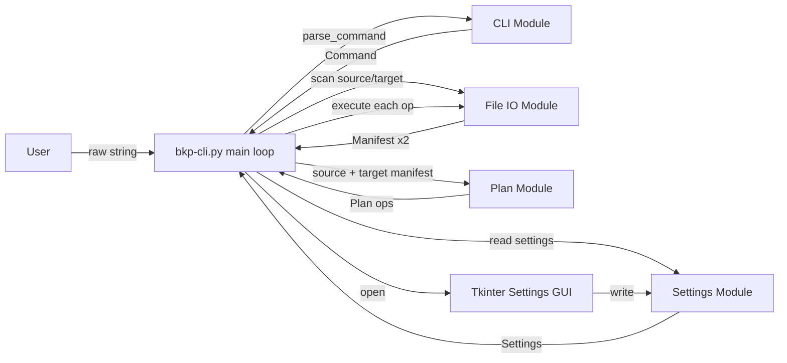

# bkp-cli Specification

## 1. Overview

`bkp-cli` is a Python CLI tool that mirrors the contents of a **source** directory into a **target** directory, recursively. It is strictly one-directional: source is read-only (never written to or deleted from), and all mutations happen on target.

The tool runs as an interactive loop (`py bkp-cli.py`) exposing five commands: `config list`, `config set`, `prepare`, `commit`, `quit`.

## 2. Goals / Non-Goals

**Goals**
- Make target's directory tree an exact structural mirror of source (same files/folders at the same relative paths).
- Never read-write-hazard source: source is only ever stat'd and read, never written or deleted.
- Keep comparison fast (metadata-based, not full content hashing) while keeping false positives (treating a changed file as unchanged) effectively impossible in normal use.
- Clean separation between pure logic (CLI parsing, plan generation) and filesystem side effects (IO module), so the former can be unit tested without touching a real filesystem.

**Non-Goals (v1)**
- Two-way sync / conflict resolution.
- Byte-for-byte content verification.
- Resuming a partially-executed `commit`.
- True rename/move detection for folders (treated as delete + re-copy — see §12).
- Symlink support.

## 3. Architecture



`bkp-cli.py` is the orchestrator: it owns the loop (`input(">> ")`), holds in-memory state (`settings`, `last_plan`), and wires the other modules together. The modules themselves do not call each other directly except where noted.

### 3.1 Modules

Aside from the `bkp-cli.py` entry point, every module lives under the `bkp_cli/` package folder (see §13) and is imported by the entry point, e.g. `from bkp_cli import cli, plan, file_io, settings, gui`.

| Module | File | Responsibility | Side effects? |
|---|---|---|---|
| CLI Module | `bkp_cli/cli.py` | Parse a raw input string into a `Command` object | None (pure) |
| Plan Module | `bkp_cli/plan.py` | Compare a source `Manifest` and target `Manifest`, produce a `Plan` | None (pure) |
| File IO Module | `bkp_cli/file_io.py` | Scan a directory into a `Manifest`; execute a single `Operation` against the filesystem | Yes (all filesystem reads/writes live here) |
| Settings Module | `bkp_cli/settings.py` | Load/save `settings.json`, validate it (including whitelist check) | Yes (file read/write) |
| GUI | `bkp_cli/gui.py` | Tkinter window for editing settings | Yes (invokes OS folder picker, calls Settings Module on Save) |
| Entry point | `bkp-cli.py` | Main loop, dispatch, orchestration, console output | Yes (print/input, calls other modules) |

This split means `cli.py` and `plan.py` have no filesystem dependency at all and can be fully unit tested with in-memory strings/dicts. `file_io.py` is kept intentionally thin (mostly direct `pathlib`/`shutil`/`os` calls) and is not a priority for unit testing per your request.

## 4. Data Structures

### 4.1 `Command` (CLI Module output)

```python
@dataclass
class Command:
    name: str                 # one of: "config_list", "config_set", "prepare", "commit", "quit", "unknown"
    raw_input: str            # original string, useful for error messages
```

`parse_command(raw: str) -> Command` trims/lowercases the input, matches it against the known command strings (`config list`, `config set`, `prepare`, `commit`, `quit`), and returns `Command(name="unknown", raw_input=raw)` for anything else. Reading the input itself happens in `bkp-cli.py` via `input(">> ")`; this function only ever receives a plain `str`.

### 4.2 `Manifest` (File IO Module output)

A manifest is a flat mapping from **relative path** (posix-style, `/`-separated, relative to the scanned root) to an entry describing that path. The root itself is not an entry.

```python
@dataclass
class ManifestEntry:
    path: str          # relative, posix-style, e.g. "docs/readme.txt"
    entry_type: str    # "file" | "dir"
    size: int | None   # bytes; None for dirs
    mtime: float | None  # epoch seconds (os.stat().st_mtime); None for dirs

Manifest = dict[str, ManifestEntry]   # key == entry.path
```

`build_manifest(root_path: str) -> Manifest` walks the tree and produces this structure. Path comparison is **case-sensitive** on all platforms (see §12.3).

### 4.3 `Operation` / `Plan` (Plan Module output)

```python
class OperationType(Enum):
    WRITE_FILE = "write-file"
    DELETE_FILE = "delete-file"
    WRITE_FOLDER = "write-folder"
    DELETE_FOLDER = "delete-folder"

@dataclass
class Operation:
    op_type: OperationType
    relative_path: str   # path the operation applies to, relative to source/target root

Plan = list[Operation]
```

`WRITE_FOLDER` / `DELETE_FOLDER` apply to an entire subtree in one step (copy/delete the whole folder recursively) rather than being expanded into per-file operations — see §9 for why.

`generate_plan(source_manifest: Manifest, target_manifest: Manifest, comparator: FileComparator) -> Plan`

### 4.4 `Settings`

```python
@dataclass
class Settings:
    source: str          # absolute path
    target: str          # absolute path
    whitelist: list[str] # absolute paths
```

Persisted as `settings.json`:

```json
{
  "source": "C:\\Users\\me\\data",
  "target": "D:\\backups\\data",
  "whitelist": ["D:\\backups"]
}
```

## 5. Settings Module Details

- `load_settings(path="settings.json") -> Settings`: if the file doesn't exist, create it with defaults (`source=""`, `target=""`, `whitelist=[]`) and return that. If it exists but is malformed JSON or missing keys, print an error and fall back to the same empty defaults (do not crash the CLI loop). The default path is resolved relative to `bkp-cli.py` at the project root (i.e. `settings.json` stays a root-level file even though `settings.py` itself lives in `bkp_cli/`).
- `save_settings(settings, path="settings.json")`: writes formatted JSON, called only from the `config set` GUI's Save action.
- `is_target_valid(settings) -> bool`: true only if `target` is non-empty, absolute, and is equal to or a descendant of at least one path in `whitelist`. Use `pathlib.Path` containment (e.g. compare via `Path.resolve()` + `os.path.commonpath`, **not** a naive `str.startswith`, since `str.startswith` would wrongly accept `D:\backups-old` as being inside whitelisted `D:\backups`).
- Whitelist checking applies **only** to `target`, per your spec — `source` is not checked against the whitelist.
- `bkp-cli.py` calls `is_target_valid` after every load (startup and after `config set`). If invalid, `prepare` and `commit` must refuse to run and tell the user to fix it via `config set`.

## 6. CLI Commands

### 6.1 Startup sequence

```
=========================================================
bkp-cli - available commands:
  config list   - show current settings
  config set    - open settings GUI
  prepare       - compare source and target, build a plan
  commit        - execute the most recently prepared plan
  quit          - exit
---------------------------------------------------------
source: <value or "(not set)">
target: <value or "(not set)"> [INVALID - outside whitelist]
=========================================================
>>
```

### 6.2 `config list`

Prints `source`, `target` (flagging if invalid per §5), and `whitelist` (one path per line, or `(empty)`).

### 6.3 `config set`

Opens the Tkinter GUI (§7), blocking the CLI loop until the window closes. On Save: settings are written to `settings.json`, then immediately reloaded from disk into memory (per your requirement), validity is re-checked, and **any existing plan is discarded** (see §6.5). On Cancel: nothing changes.

### 6.4 `prepare`

1. Reload settings validity check: if `target` invalid or either `source`/`target` empty/missing on disk, print an error and do nothing.
2. Build `Manifest` for `source` and `target` via File IO Module.
3. Call `generate_plan`.
4. If the plan is empty, print `source and target already match - nothing to do` and clear any stored plan.
5. Otherwise, print a human-readable summary (counts per operation type, optionally the full list) and store the plan in memory as "the current plan".

### 6.5 `commit`

1. If no current plan exists (never prepared, or invalidated by a later `prepare`/`config set`), print `no plan to commit - run 'prepare' first` and do nothing.
2. Otherwise print a summary of the stored plan and ask for confirmation (`commit N operations? [y/N]`).
3. On confirmation, execute operations **in the order they appear in the plan** (deletes before writes — see §9.3), calling `file_io.execute_operation` for each.
4. **Abort on first failure**: stop at the first operation that fails, report which operation failed and why, and report how many of the N operations completed successfully before the failure. The plan is cleared afterward either way (success or partial failure) — the user must run `prepare` again to get a fresh plan reflecting the now-changed target state.
5. On full success, print a completion summary and clear the stored plan.

### 6.6 `quit`

Exits the loop/process. No confirmation needed (nothing destructive about quitting).

### 6.7 Unknown input

Print `unknown command: <input>` and re-prompt.

## 7. `config set` GUI (Tkinter)

Single modal window, laid out top-to-bottom:

1. **Source row**: read-only label/entry showing current `source`; a "Browse…" button opening `tkinter.filedialog.askdirectory()` which updates the displayed (in-memory, unsaved) value.
2. **Target row**: same as above for `target`.
3. **Whitelist section**: a scrollable list of current whitelist paths, each row with a "Remove" button that removes that entry from the in-memory (unsaved) list; below the list, an "Add…" button opening `askdirectory()` that appends the chosen path to the in-memory list (de-duplicated).
4. **Save** button: writes the in-memory `source`/`target`/`whitelist` values to `settings.json` and closes the window.
5. **Cancel** button: closes the window, discarding all in-memory edits; `settings.json` is untouched.

All edits are held in local widget/window state until Save is pressed — nothing touches `settings.json` until then, satisfying the "Cancel writes nothing" requirement.

## 8. File Comparison Strategy

### 8.1 Your proposed criterion, and the recommendation you accepted

Pure mtime-equality has a narrow but real false-positive risk: filesystem timestamp granularity (e.g. FAT32's 2-second resolution) or an intervening touch/restore could make a changed file's mtime coincidentally equal to the old target copy's mtime. Per your decision, the default comparator checks **both mtime and size** — a changed file very rarely has byte-identical size to its predecessor, so this closes almost all of that gap while remaining a pure metadata check (no file content is ever read during comparison).

A file is considered "same" only if `size` and `mtime` are both equal between source and target entries; any difference in either triggers a `write-file`.

### 8.2 Pluggable comparator interface

```python
class FileComparator(Protocol):
    def are_equal(self, source_entry: ManifestEntry, target_entry: ManifestEntry) -> bool: ...
```

`plan.generate_plan` takes a `comparator` argument (defaulting to `MtimeSizeComparator`). This keeps the door open for a future `HashComparator` (e.g. SHA-256, for stronger guarantees at the cost of reading file content) without changing the Plan Module's structure. `os.stat()` (which backs size/mtime) behaves consistently on both Windows and Linux, so no platform-specific comparator is needed for v1 — the extensibility point is about comparison *strategy* (metadata vs. hash), not platform.

### 8.3 Preserving mtime on copy

Per your decision, `write-file` copies use `shutil.copy2` (not `shutil.copy`), which preserves the source file's mtime on the target copy. This is required for the comparator to work correctly on the *next* `prepare` — without it, every copied file would appear "changed" again on the very next run.

## 9. Folder Comparison & Plan Generation

### 9.1 Folder equality

Folders are matched by **relative path only** (name + position in the tree), not content. A folder at the same relative path in both source and target is considered "the same folder" regardless of its contents; contents are compared by recursing into it.

### 9.2 Algorithm (illustrative, not final code)

```python
def generate_plan(source, target, comparator):
    ops = []
    covered = set()  # relative paths already fully handled by a folder op

    def covered_by(path):
        return any(path == p or path.startswith(p + "/") for p in covered)

    # Pass 1: things to remove from target (missing in source, or type changed)
    for path in sorted(target):  # shallowest first, so parents are visited before children
        if covered_by(path):
            continue
        t_entry = target[path]
        s_entry = source.get(path)
        if s_entry is None or s_entry.entry_type != t_entry.entry_type:
            op_type = DELETE_FOLDER if t_entry.entry_type == "dir" else DELETE_FILE
            ops.append(Operation(op_type, path))
            if t_entry.entry_type == "dir":
                covered.add(path)

    covered.clear()

    # Pass 2: things to add/update in target
    for path in sorted(source):  # shallowest first
        if covered_by(path):
            continue
        s_entry = source[path]
        t_entry = target.get(path)
        if t_entry is None or t_entry.entry_type != s_entry.entry_type:
            op_type = WRITE_FOLDER if s_entry.entry_type == "dir" else WRITE_FILE
            ops.append(Operation(op_type, path))
            if s_entry.entry_type == "dir":
                covered.add(path)
        elif s_entry.entry_type == "file" and not comparator.are_equal(s_entry, t_entry):
            ops.append(Operation(WRITE_FILE, path))

    return ops
```

Key points:
- Both passes iterate in **shallowest-first** order (plain ascending `sorted()`). Since an ancestor path is always a string-prefix of its descendants, ancestors always sort before descendants, guaranteeing a parent folder's `WRITE_FOLDER`/`DELETE_FOLDER` op is emitted — and the parent added to `covered` — before any of its children are visited. This is required for the `covered_by` check to correctly skip descendants and avoid emitting redundant nested ops (e.g. a `delete-folder` for `a/b` *and* a separate, unnecessary one for its parent `a`).
- A `WRITE_FOLDER`/`DELETE_FOLDER` op is emitted once for the top of a missing/extra subtree; descendants under that path are **not** separately enumerated (the IO module's `shutil.copytree` / `shutil.rmtree` handles the whole subtree in one operation).
- A path that exists as a **file** in one side and a **directory** in the other is treated as delete-then-write (handled naturally since the type mismatch triggers both passes).
- Per your decision, empty folders in source (no files anywhere in their subtree) still get a `WRITE_FOLDER` op so target's structure fully mirrors source's, including empty directories.

### 9.3 Operation ordering

All delete operations are listed before all write operations. This guarantees that if a path is changing type (file→folder or folder→file) or a name is being "freed up" by a rename-as-delete+recopy (§12.1), the removal always happens before anything tries to occupy that path.

## 10. File IO Module Details

- `build_manifest(root: str) -> Manifest`: walks `root` with `os.walk` (or `pathlib.Path.rglob`), skipping symlinks (§12.2), recording relative posix-style paths.
- `execute_operation(op: Operation, source_root: str, target_root: str) -> bool`: resolves `op.relative_path` against the appropriate root(s) and performs:
  - `WRITE_FILE` → ensure parent dir exists in target, `shutil.copy2(source_path, target_path)`.
  - `DELETE_FILE` → `os.remove(target_path)`.
  - `WRITE_FOLDER` → `shutil.copytree(source_path, target_path, copy_function=shutil.copy2)`.
  - `DELETE_FOLDER` → `shutil.rmtree(target_path)`.
  
  Catches any `OSError`/`shutil.Error`, logs the reason, and returns `False` on failure rather than raising — so `bkp-cli.py`'s commit loop can implement the "abort on first failure" behavior from §6.5 without needing a try/except around every call.

## 11. Error Handling Summary

| Situation | Behavior |
|---|---|
| `settings.json` missing | Created with empty defaults |
| `settings.json` malformed | Error printed, empty defaults used in memory (file not overwritten until a `config set` Save) |
| `target` not under any whitelist entry | `prepare`/`commit` refuse to run; `config list` flags it |
| `prepare` with empty/invalid source or target | Refuses, prints reason |
| `commit` with no stored plan | Refuses, prints `no plan to commit - run 'prepare' first` |
| Operation fails during `commit` | Abort immediately, report partial progress, clear stale plan |
| Unknown CLI command | Print `unknown command: <input>`, re-prompt |

## 12. Notable Edge Cases & Deferred Scope

### 12.1 Folder renames

A folder renamed in source (same content, different name/path) is indistinguishable from "an unrelated new folder" under path-based matching, and per your decision this is **explicitly deferred**: v1 treats it as `delete-folder` (old name) + `write-folder` (new name). A future enhancement could attempt content-based matching (e.g., hashing each folder's manifest subtree and looking for a match elsewhere in target before falling back to delete+recopy) to turn this into a cheap `os.rename`, but that's out of scope for v1.

### 12.2 Symlinks

Not supported in v1. `build_manifest` detects symlinks (`os.path.islink`) and skips them, logging a warning (`skipping symlink: <path>`) rather than failing the whole scan.

### 12.3 Case sensitivity

Per your decision, path comparisons are always case-sensitive, on every platform. In practice this is mostly moot on Windows since its filesystems are case-insensitive and won't allow two sibling entries differing only by case to begin with; the explicit case-sensitive comparison just means no `.lower()` normalization is applied anywhere in the Plan Module.

### 12.4 Source/target containment

`bkp-cli.py` should refuse to `prepare`/`commit` if `target` is equal to, or a parent/child of, `source` (comparing resolved absolute paths) — mirroring into a path that overlaps source could otherwise corrupt source indirectly. This check happens alongside the whitelist validity check.

## 13. Project Structure

Per your preference, the project root contains only `bkp-cli.py` and the runtime-generated `settings.json`; every other module lives inside the `bkp_cli/` package folder, and tests live in their own `tests/` folder:

```
bkp-cli/
  bkp-cli.py            # entry point: main loop, dispatch, console I/O
  settings.json          # generated at runtime, not checked in
  bkp_cli/
    __init__.py
    cli.py               # parse_command()
    plan.py              # generate_plan(), Operation/OperationType, FileComparator, MtimeSizeComparator
    file_io.py           # build_manifest(), execute_operation()
    settings.py          # Settings dataclass, load_settings(), save_settings(), is_target_valid()
    gui.py               # Tkinter config-set window
  tests/
    test_cli.py
    test_plan.py
```

## 14. Testing Strategy

Per your preference to avoid external dependencies, tests use Python's built-in `unittest` framework (runnable via `py -m unittest discover`) rather than `pytest`. Note that aside from this choice of test runner, nothing else in this spec requires a third-party package — `dataclasses`, `enum`, `json`, `pathlib`, `os`, `shutil`, and `tkinter` (incl. `tkinter.filedialog`) are all part of the Python standard library, so the project has zero external runtime or test dependencies.

- **CLI Module**: `unittest.TestCase` cases feeding strings (`"config list"`, `" PREPARE "`, `"nonsense"`, etc.) into `parse_command`, asserting the resulting `Command`.
- **Plan Module**: `unittest.TestCase` cases constructing small in-memory `Manifest` dicts by hand (no filesystem involved) covering: identical trees (empty plan), added/removed files, added/removed folders (incl. empty folders), changed files (mtime/size diffs), file↔folder type swaps, and a fake/stub `FileComparator` to isolate plan logic from comparison logic.
- **File IO Module**: not a priority per your request; a few smoke tests using `tempfile.TemporaryDirectory` are optional but not required.

## 15. Open Items / Future Enhancements

- Rename detection for folders (§12.1).
- Optional hash-based `FileComparator` for stronger-than-metadata verification.
- Symlink support.
- Resume/rollback support for interrupted `commit` runs.
